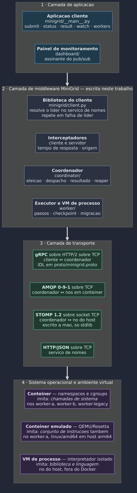
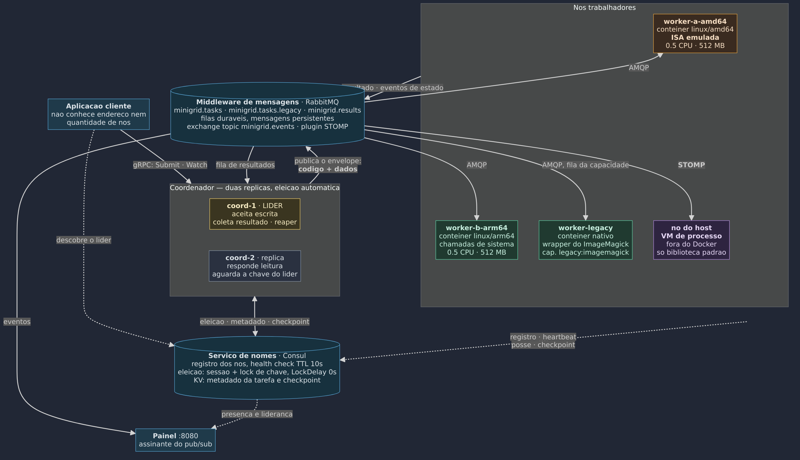
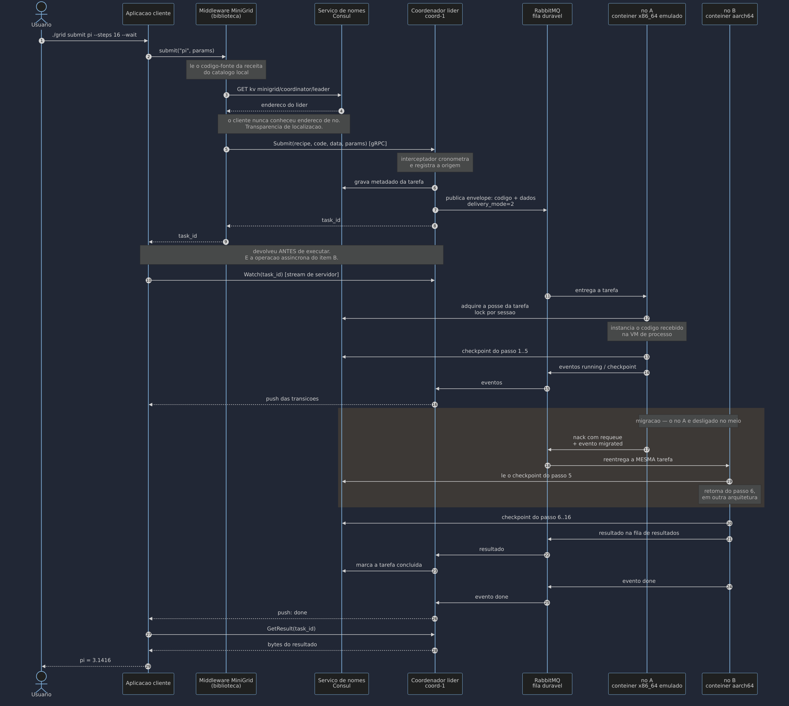

# MiniGrid — Relatório Técnico de Implementação

Trabalho de Sistemas Distribuídos. Sistema de computação em grade em miniatura,
no qual o grupo implementa a própria camada de middleware entre a aplicação e a
camada de transporte.

Toda afirmação deste relatório aponta para um arquivo e, quando é afirmação de
comportamento, para o teste que a verifica contra o sistema em execução. A
suíte define **184 testes** — 180 passam e 4 ficam em *skip* quando a
biblioteca ou o ambiente correspondente não está presente. Desses,
`tests/test_rubrica.py` contém **25, um por exigência do enunciado**, rodando contra o `docker compose` de verdade — não
contra simulações.

## Diagramas

São três, porque um único desenho tentando mostrar camadas, topologia e ordem
temporal ao mesmo tempo fica ilegível — e os três recortes são exatamente o que
o enunciado pede do diagrama de arquitetura. As fontes `.mmd` estão versionadas
ao lado dos PNGs.

### As camadas do sistema



### Topologia: serviço de nomes, réplicas e virtualização por nó



### O caminho de uma tarefa, do RPC do cliente até o trabalhador

Inclui a faixa de migração: a mesma tarefa trocando de nó e retomando do último
ponto de verificação.



---

## 1. A interface do middleware e as transparências oferecidas

### 1.1 A interface

O middleware é uma biblioteca que a aplicação importa (`minigrid/client.py`).
A superfície é pequena de propósito:

| Operação | Assinatura | Natureza |
|---|---|---|
| submeter | `submit(recipe, data, params, code, requires) -> task_id` | **assíncrona** — devolve o identificador sem esperar a execução |
| consultar estado | `status(task_id) -> dict` | síncrona |
| obter resultado | `result(task_id) -> bytes` | síncrona |
| acompanhar | `watch(task_id) -> Iterator[dict]` | **assíncrona** — recebe as transições por push |
| conveniência | `wait(task_id) -> bytes` | acompanha até terminar e devolve o resultado |
| introspecção | `workers() -> dict` | síncrona |

O que **não** existe em nenhuma dessas assinaturas, nem em nenhuma mensagem do
`proto/minigrid.proto`: endereço de trabalhador, quantidade de trabalhadores,
nome de fila, identificação de qual réplica de coordenador atender. O cliente
conhece um endereço de serviço de nomes e nada mais.

> Verificado por `test_a_cliente_nao_conhece_endereco_de_worker`, que inspeciona
> os campos declarados em `SubmitRequest` e falha se algum deles for de endereço.

### 1.2 As quatro transparências

**Transparência de acesso.** `submit("pi", ...)`, `submit("compress", ...)` e
`submit("img.filter", ...)` são a mesma chamada. A primeira é cálculo numérico
puro; a terceira invoca um programa legado de linha de comando por trás de um
wrapper. A aplicação não distingue, e o código enviado também não: para a
receita, o ImageMagick é a função `api.run_legacy(...)`.

**Transparência de localização.** O endereço do coordenador não está em
configuração alguma do cliente. `MiniGridClient._resolve_leader` lê a chave
`minigrid/coordinator/leader` do serviço de nomes e disca para o que encontrar.
Qual trabalhador executa a tarefa é decisão do broker, e nem o cliente nem o
coordenador participam dela.

**Transparência de migração.** O `task_id` e o `watch` continuam válidos depois
de a tarefa trocar de nó. Para quem chamou, a migração é invisível; o que
aparece, se alguém olhar os eventos, é uma transição `migrated` com o motivo.

**Transparência de falhas.** A queda do coordenador líder chega à biblioteca
como `UNAVAILABLE` ou `FAILED_PRECONDITION`. `MiniGridClient._call` captura as
duas, reconsulta o serviço de nomes, reabre o canal na outra réplica e repete a
chamada. A aplicação não vê erro; vê uma pausa.

> Verificado por `test_f_cliente_absorve_a_queda_do_lider_sem_erro`, que mata o
> contêiner do líder com `docker kill` no meio de uma sessão e exige que a
> submissão seguinte funcione — **sem** tratar exceção, de propósito: se o
> cliente não absorvesse, o teste falharia com o erro que a aplicação teria visto.

### 1.3 Middleware adaptável: interceptador e wrapper

**Interceptador** (`coordinator/interceptor.py`). O enunciado pede "pelo menos um
interceptador, que capture todas as chamadas para registrar tempo de resposta e
origem". No gRPC isso é recurso nativo — `grpc.ServerInterceptor` entra na cadeia
antes do servicer e vê todas as chamadas sem uma linha de código dentro dos
handlers. Por chamada são capturados: método, **origem** (`context.peer()`),
identidade lógica do cliente (metadado `x-minigrid-client-id`, injetado pelo
interceptador *cliente*), **tempo de resposta** em milissegundos, código de
status final e, em streams, quantas mensagens saíram.

Dois pontos de implementação que não são óbvios:

- O rastreio é emitido no `finally`, não no caminho de sucesso. `context.abort()`
  levanta de dentro do handler e só então o código de status fica legível no
  contexto; emitir no caminho feliz perderia justamente as chamadas que falharam.
- O interceptador também embrulha `unary_stream`, não só `unary_unary`. Sem isso
  o `Watch` — a operação assíncrona do item B — seria a única chamada do sistema
  sem rastreio, e o enunciado pede "todas as chamadas".

**Wrapper de programa legado** (`worker/legacy.py`). O programa é o ImageMagick:
existe desde 1990, não sabe que o MiniGrid existe, não fala gRPC nem AMQP, e sua
única interface é `argv` mais `stdin`/`stdout` mais código de saída. O wrapper
traduz nas duas direções — tarefa → `argv` + `stdin`, `stdout` → resultado,
código de saída diferente de zero → `LegacyFailed`, que o executor publica como
`failed`. E ele chega ao código móvel como *chamada de biblioteca*. É esse o
sentido de "tratando-o como um serviço como qualquer outro".

O wrapper aceita um **nome lógico de serviço** (`"imagemagick"`), não um
binário. Quem sabe se a máquina tem `convert` (ImageMagick 6) ou `magick`
(versão 7) é o wrapper, não a receita — do contrário a transparência que ele
deve dar seria quebrada pelo próprio código que a usa.

> Verificado por `test_a_interceptador_registra_tempo_e_origem` e
> `test_a_wrapper_de_programa_legado_executa`, que submete uma imagem e exige um
> PNG válido de volta, executado no nó `worker-legacy`.

---

## 2. Frameworks de comunicação e o motivo da escolha

### 2.1 Cliente ↔ coordenador: gRPC

**Por quê.** Três razões, em ordem de peso:

1. **A IDL é explícita.** `proto/minigrid.proto` é a definição formal da
   interface, versionada e legível por humanos. Uma API REST teria a interface
   espalhada por rotas e documentação informal.
2. **Streaming de servidor resolve o requisito assíncrono sem polling.** O item B
   exige que o cliente "seja notificado quando o resultado estiver pronto".
   `Watch` é um *server stream*: o coordenador empurra cada transição. Com REST
   seria polling ou webhook — o primeiro desperdiça, o segundo exigiria o cliente
   ser servidor.
3. **Interceptador é nativo.** O conceito que o enunciado cobra tem suporte de
   primeira classe no framework, e o termo do Tanenbaum é literalmente o nome da
   feature.

**Como a interface foi definida.** Em `proto/minigrid.proto`, proto3: cinco RPCs
(`Submit`, `GetStatus`, `GetResult`, `Watch`, `ListWorkers`), nove mensagens e
um enum de estado. Os stubs são gerados por `scripts/gen_proto.sh`, que roda o
`grpc_tools.protoc` num contêiner descartável — a meta de zero instalação vale
também para as ferramentas de build.

**Como o framework trata o empacotamento.** O protobuf serializa cada mensagem
num formato binário compacto com campos numerados, e o gRPC a transporta sobre
HTTP/2 sobre TCP. Do lado da aplicação, nada disso aparece: chama-se um método
com tipos da linguagem e recebe-se um objeto. A numeração dos campos é o que dá
compatibilidade — acrescentar um campo novo não quebra um cliente antigo.

Um detalhe que custou um defeito e vale registrar: **o teto padrão de mensagem
do gRPC é 4 MB**. O sistema anuncia 8 MB de payload; sem elevar o limite nas
duas pontas, uma tarefa de 8 MB era recusada pelo *transporte* com
`RESOURCE_EXHAUSTED` antes de chegar à validação do coordenador — ou seja, o
limite documentado era falso, e o erro que o usuário recebia era opaco. A
constante `envelope.GRPC_MAX_MESSAGE` é aplicada no servidor, na biblioteca do
cliente e nos testes a partir de um único lugar, para as três pontas não
divergirem.

> Verificado por `test_submit_rejects_payload_over_the_limit` (exige
> `INVALID_ARGUMENT` com a mensagem explicada, não `RESOURCE_EXHAUSTED`),
> `test_submit_accepts_a_payload_just_under_the_limit` (guarda o outro lado:
> baixar o limite demais passaria calado) e
> `test_result_larger_than_the_grpc_default_can_be_fetched`.

### 2.2 Coordenador ↔ trabalhadores: RabbitMQ

**Por quê.** O item C exige filas persistentes e um modelo de publicação e
assinatura. O RabbitMQ entrega os dois no mesmo broker: filas duráveis para as
tarefas e um `exchange` do tipo `topic` para os eventos. E, decisivo para este
projeto, ele tem o plugin **STOMP**, que é o que torna possível o nó que roda
fora do Docker sem instalar nada (§2.3).

**Topologia** (`coordinator/topology.py`), declarada pelo coordenador no boot:

| Canal | Tipo | Quem consome |
|---|---|---|
| `minigrid.tasks` | fila durável | nós genéricos (`worker-a`, `worker-b`, nó do host) |
| `minigrid.tasks.legacy` | fila durável | apenas `worker-legacy` |
| `minigrid.results` | fila durável | coordenador líder |
| `minigrid.events` | exchange `topic` | painel, `Watch`, qualquer assinante |

O roteamento é **por capacidade, não por endereço**: o envelope declara
`requires: ["legacy:imagemagick"]` e isso escolhe a fila. Trocar qual nó atende
qual capacidade não exige mudar uma linha do cliente.

### 2.3 Coordenador ↔ nó do host: STOMP escrito à mão

O nó que roda fora do Docker (item G) não pode instalar nada na máquina do
avaliador. Isso elimina o `pika`, porque AMQP 0-9-1 é um protocolo binário que
exigiria biblioteca. STOMP é um protocolo de **texto** que cabe em `socket` da
biblioteca padrão, e o RabbitMQ o expõe pelo plugin `rabbitmq_stomp`.

`minigrid/stomp.py` implementa o cliente em 240 linhas: `CONNECT`, `SEND`,
`SUBSCRIBE`, `ACK`, `NACK`, frames terminados em nulo. Assinando
`/amq/queue/minigrid.tasks`, ele consome da **mesma fila durável** que os nós em
contêiner — não de uma fila paralela.

O ganho não é só de dependência. O item A exige o sistema organizado em camadas
incluindo a **camada de transporte**, e em todo o resto do projeto o transporte
fica escondido dentro do gRPC e do pika. Aqui o socket é aberto, o frame é
montado e a camada aparece.

Dois detalhes de implementação que a especificação exige e são fáceis de errar:

- **`content-length` em todo frame.** Sem ele o broker trata o corpo como texto
  terminado em nulo, e um byte nulo no payload corta a mensagem.
  Verificado por `test_body_with_null_byte_survives_the_frame`.
- **Buffer de instância entre leituras.** Dois frames podem chegar no mesmo
  pacote TCP; ler um por `recv` perderia o segundo — tarefa perdida em silêncio
  sob carga. Verificado por
  `test_multiple_frames_in_one_tcp_read_are_both_delivered`.

> Antes de qualquer código ser escrito sobre STOMP, um *spike* descartável
> verificou contra o broker real que `NACK` com `requeue:true` reentrega a mesma
> mensagem numa fila `/amq/queue/` — porque a migração do item E depende disso.
> Se tivesse falhado, o plano B (vendorizar o `pika` no repositório) entraria
> ali, sem retrabalho.

### 2.4 Serviço de nomes: HTTP/JSON

O Consul expõe tudo por HTTP/JSON, o que permite falar com ele usando
`urllib.request` da biblioteca padrão (`minigrid/naming.py`). É o que mantém o
nó do host livre de dependências também desse lado.

---

## 3. Classificação dos fluxos de comunicação

O enunciado pede a classificação de **cada** fluxo quanto a sincronismo,
persistência e granularidade.

| # | Fluxo | Protocolo | Sincronismo | Persistência | Granularidade |
|---|---|---|---|---|---|
| 1 | `Submit` cliente → coordenador | gRPC | **assíncrona** — devolve o id sem esperar a execução | transiente | discreta |
| 2 | `GetStatus` cliente → coordenador | gRPC | síncrona | transiente | discreta |
| 3 | `GetResult` cliente → coordenador | gRPC | síncrona | transiente | discreta |
| 4 | `Watch` coordenador → cliente | gRPC server stream | **assíncrona**, por push | transiente | **fluxo** |
| 5 | `ListWorkers` cliente → coordenador | gRPC | síncrona | transiente | discreta |
| 6 | Tarefa coordenador → nó em contêiner | AMQP | assíncrona | **persistente** | discreta |
| 7 | Tarefa coordenador → nó do host | **STOMP** | assíncrona | **persistente** | discreta |
| 8 | Resultado nó → coordenador | AMQP / STOMP | assíncrona | **persistente** | discreta |
| 9 | Eventos de estado da tarefa | AMQP topic | assíncrona, pub/sub | transiente | **fluxo** |
| 10 | Rastreio de RPC (interceptador) | AMQP topic | assíncrona, pub/sub | transiente | **fluxo** |
| 11 | Painel → navegador | SSE sobre HTTP | assíncrona, por push | transiente | **fluxo** |
| 12 | Registro e heartbeat no serviço de nomes | HTTP/JSON | síncrona | transiente | discreta |
| 13 | Consulta bloqueante do seguidor | HTTP/JSON | síncrona com espera longa | transiente | discreta |
| 14 | Checkpoint nó → serviço de nomes | HTTP/JSON | síncrona | **persistente** (KV) | discreta |

**As linhas 6, 7 e 8 são persistentes e as 9 e 10 não são — e isso é desenho,
não descuido.** O que não pode se perder é a *tarefa*: ela trafega em fila
durável com `delivery_mode=2`, sobrevive a restart do broker e espera se nenhum
nó estiver vivo. Um *evento de estado* perdido não prejudica nada, porque o
estado autoritativo está no serviço de nomes; o exchange existe para notificar,
não para guardar.

A consequência prática foi um defeito real durante a construção: a falha de uma
tarefa era publicada *apenas* como evento, que é transiente, e portanto o estado
autoritativo ficava `received` para sempre — `GetStatus` mentia e `watch()`
nunca retornava. A correção foi fazer a falha percorrer o mesmo caminho durável
do resultado (`Transport.report_failure`). Registra-se aqui porque é exatamente
o tipo de erro que a tabela acima existe para evitar.

> As linhas 6 e 7 são verificadas por `test_c_mensagem_de_tarefa_e_persistente`
> (exige `delivery_mode == 2` na mensagem real) e
> `test_c_fila_persistente_nao_perde_tarefa_com_worker_desligado` (10 tarefas
> submetidas sem nenhum consumidor; ao subir um nó, as 10 completam). A linha 9 é
> verificada por `test_c_pubsub_entrega_a_dois_assinantes_simultaneos`, que exige
> que **ambos** os assinantes recebam todas as transições — numa fila
> compartilhada, um roubaria o evento do outro.

---

## 4. Comparação entre os ambientes de virtualização

O enunciado pede dois tipos; o sistema tem **três ambientes distintos**, porque
o contêiner emulado imita uma interface a mais que o contêiner nativo.

### 4.1 Qual interface cada ambiente está imitando

| Ambiente | Interface imitada | Mecanismo | Onde |
|---|---|---|---|
| Contêiner nativo | **chamadas de sistema** | namespaces (PID, rede, montagem) + cgroups, kernel compartilhado | `worker-b-arm64`, `worker-legacy` |
| Contêiner emulado | chamadas de sistema **+ conjunto de instruções** | o acima, mais tradução de ISA por QEMU/Rosetta | `worker-a-amd64` num host arm64 |
| VM de processo | **biblioteca e linguagem** | máquina virtual de bytecode do CPython + superfície restrita da stdlib | nó do host, fora do Docker |

A VM de processo é o segundo tipo exigido pelo item D, e o enunciado a permite
explicitamente: "uma máquina virtual de processo (como a JVM ou um interpretador
isolado que execute o código enviado)".

### 4.2 Custo de inicialização — medido

`scripts/bench_boot.sh`, 3 repetições, host `aarch64`:

| Ambiente | Média | Relativo |
|---|---|---|
| VM de processo | **0,050 s** | 1,0× |
| Contêiner nativo | **0,381 s** | 7,6× |
| Contêiner emulado | **0,516 s** | 10,3× |

A ordenação é a esperada e diz algo que vale ser dito: **quanto mais fina a
camada que o ambiente imita, mais barato iniciá-lo.** A VM de processo só precisa
de um `fork`/`exec` de interpretador. O contêiner precisa montar namespaces,
aplicar cgroups e construir uma árvore de sistema de arquivos em camadas. O
contêiner emulado paga tudo isso mais a tradução de instruções.

Não existe ambiente de virtualização "melhor" — existe troca entre custo de
partida e grau de isolamento, e os números acima são essa troca em segundos.

### 4.3 Isolamento — medido, inclusive onde ele falha

Cada ambiente foi submetido à mesma tarefa: alocar 1 GB sob um limite de 128 MB.

| Ambiente | Resultado | Leitura |
|---|---|---|
| Contêiner nativo (`aarch64`) | `MemoryError` | `RLIMIT_AS` aplicado pelo kernel |
| Contêiner emulado (`x86_64`) | morto por sinal, `rosetta error: mmap failed` | limite aplicado, por outra via |
| VM de processo no macOS | **a alocação passou** | o kernel do Darwin **não aplica** `RLIMIT_AS` |

A terceira linha é a mais importante deste relatório, por dois motivos.

Primeiro, porque é uma limitação real: no macOS, `setrlimit` aceita o limite e o
kernel o ignora, e nem `setrlimit` nem `getrlimit` revelam isso. Um relatório
descuidado afirmaria isolamento de memória que não existe.

Segundo, porque **o sistema declara essa limitação sozinho, em tempo de
execução**: o sandbox reporta em `limits_skipped` quais limites não foram
aplicados, e o teste correspondente
(`test_memory_limit_is_either_enforced_or_declared_as_not_enforced`) exige uma
das duas coisas — limite aplicado, ou não-aplicação declarada. Não há caminho em
que o sistema passe por isolado sem ser.

### 4.4 O que a VM de processo isola, e o que não isola

**Isola:**

- processo separado — laço infinito ou estouro de memória mata o processo filho,
  não o nó;
- `python3 -I -S` — sem `site-packages`, sem variáveis de ambiente, sem o
  diretório corrente no `sys.path`;
- espaço de nomes da linguagem — `__builtins__` reduzido a lista branca (sem
  `open`), e um `__import__` próprio que recusa qualquer módulo fora de
  `{math, random, json, base64, zlib, hashlib, struct, time}`;
- limites de recurso por `setrlimit`: tempo de CPU, espaço de endereçamento,
  tamanho de arquivo;
- diretório de trabalho temporário por tarefa, destruído ao fim.

**Não isola, e isto vai declarado:** compartilha kernel e visão de sistema de
arquivos com o usuário do host. Não há namespaces. O que ela isola é o espaço de
nomes da linguagem e os limites de recurso — não o sistema operacional.

Uma decisão de implementação vale registro: a checagem de import fica no
`__import__` da lista branca de builtins, **não** num finder em `sys.meta_path`.
Um módulo que o próprio runner já importou (`os`, `sys`, `json`) está em
`sys.modules` e seria devolvido sem passar pelo `meta_path` — o bloqueio seria
furado justamente nos módulos mais perigosos.

### 4.5 Heterogeneidade de arquitetura

As plataformas são **fixadas** no `docker-compose.yml`: `worker-a` é
`linux/amd64` e `worker-b` é `linux/arm64`. Em qualquer host, exatamente um dos
dois está emulado — no Apple Silicon é o `amd64`, num PC x86_64 e no runner do
CI é o `arm64`. Isso elimina a dependência da arquitetura de quem corrige: não
há "o nativo e o emulado", há os dois declarados, e o sistema reporta qual foi
qual em cada tarefa.

O nó do host acrescenta **heterogeneidade de sistema operacional**: Darwin ou
Linux do host contra Linux dos contêineres, visível na tag `os:` do registro.

> Verificado por `test_d_tarefas_executam_em_arquiteturas_diferentes`, que
> submete 24 tarefas e exige que ao menos duas arquiteturas apareçam nos
> resultados, e por `test_d_conteineres_declaram_limites_de_cpu_e_memoria`, que
> inspeciona o cgroup do contêiner em execução.

Um defeito encontrado aqui merece registro, porque ilustra como uma quebra pode
ser invisível. O limite de espaço de endereçamento estava em 192 MB. `RLIMIT_AS`
limita espaço **virtual**, e a camada de emulação reserva muito espaço virtual
para as próprias estruturas de tradução: **toda** tarefa no nó emulado morria
antes do primeiro passo. O nó aparecia registrado e saudável no painel e no
serviço de nomes, e simplesmente nunca entregava nada — o item D estava morto
sem nenhum sinal de erro. Medido: o emulado precisa de **≥768 MB** só para
iniciar (falha em 192 e em 384, passa em 768); o nativo roda com 192 MB.

---

## 5. Estratégia de checkpoint e migração

### 5.1 Mobilidade fraca

A tarefa viaja como **código-fonte mais dados de entrada**. O catálogo de
receitas fica no lado do cliente (`minigrid/recipes/`); `submit("pi", ...)` lê o
arquivo `.py` e envia o **texto** no envelope. O nó recebe, instancia e executa
no seu ambiente virtual. Esses arquivos **não são importados** pelo nó — se
fossem, não haveria mobilidade nenhuma, só uma chamada local.

> Verificado por `test_e_tarefa_viaja_como_codigo_mais_dados`, que espia o
> envelope na fila e exige encontrar `def step(` dentro dele.

### 5.2 O contrato de passo e o checkpoint

Toda receita implementa:

```python
def step(state, data, api) -> (novo_state, concluido, resultado_ou_None)
```

O executor (`worker/executor.py`) carrega o checkpoint se existir, chama `step`
em laço, e a cada N passos persiste o `state` como JSON em
`minigrid/tasks/<id>/checkpoint` no serviço de nomes.

**Exigência sobre quem escreve receita:** `step` precisa ser determinística dado
o `state`. A entrega é ao-menos-uma-vez e o passo *k* pode ser reexecutado,
possivelmente em outra arquitetura. A receita `pi` semeia o gerador aleatório a
partir do **número do passo**, não do relógio — sem isso, a mesma tarefa daria
respostas diferentes dependendo de onde foi interrompida, e "retomar" deixaria
de significar coisa alguma.

> Verificado por `test_pi_resumed_midway_gives_the_same_answer_as_uninterrupted`,
> que compara a execução direta contra a execução interrompida no passo 3 e
> retomada por outro nó, e exige resultado idêntico.

### 5.3 Os três gatilhos de migração

| Gatilho | Mecanismo | Quem detecta |
|---|---|---|
| **Desligamento** do nó | SIGTERM → o nó cede *entre passos*, devolve a mensagem à fila (`nack` com requeue) e publica `migrated` | o próprio nó |
| **Sobrecarga** | carga acima do limiar → mesmo caminho, com `reason=overload` | o próprio nó |
| **Queda abrupta** | o nó não tem chance de devolver nada; o health check expira no serviço de nomes e o coordenador republica a tarefa | `coordinator/reaper.py` |

O terceiro não é redundante com o requeue do broker: o broker só reentrega
quando a *conexão* cai, e uma conexão TCP pode ficar aberta e muda por muito
tempo. O TTL do serviço de nomes é o relógio independente que resolve isso.

Uma sutileza de configuração sustenta o reaper e vale explicar, porque é o tipo
de coisa que quebra em silêncio: a sessão do **nó** usa `Behavior=release`,
enquanto a do **coordenador** usa `Behavior=delete`. Com `delete`, a morte do nó
apagaria a chave `owner` junto com o lock — e o reaper, que procura exatamente
por tarefas cujo dono desapareceu, não teria o que republicar. Com `release`, o
lock é liberado e o valor fica. No coordenador o requisito é o oposto: lá a
chave *precisa* desaparecer para o seguidor conseguir adquiri-la.

### 5.4 Migração entre ambientes heterogêneos

**Por que funciona:** nada do que migra depende de plataforma. O código é texto,
o checkpoint é JSON, os dados são bytes. Um checkpoint gravado por um nó
`aarch64` é retomado sem tradução por um nó `x86_64` emulado ou pela VM de
processo no macOS.

**Evidência medida.** Durante uma rodada de testes, o painel capturou três
migrações, cada uma atravessando ambientes:

| Origem | Destino |
|---|---|
| `aarch64` contêiner, passos 0→7 | `x86_64` contêiner emulado, passos 7→16 |
| `x86_64` contêiner emulado, passos 0→4 | `aarch64` contêiner, passos 4→14 |
| `x86_64` contêiner emulado, passos 0→1 | **`arm64` VM de processo no macOS**, passos 1→8 |

A terceira atravessa arquitetura, tipo de virtualização **e** sistema operacional
de uma vez.

> Verificado por `test_e_migracao_atravessa_arquiteturas_diferentes`, que
> controla quais nós estão de pé para que a tarefa comece obrigatoriamente no nó
> emulado e seja retomada obrigatoriamente no nativo, e exige que a família de
> arquitetura mude. O teste normaliza `arm64` e `aarch64` para a mesma família —
> são a mesma ISA com nomes diferentes, e comparar as strings cruas aceitaria
> evidência falsa.

### 5.5 Recursos locais reestabelecidos no destino

| Recurso | Tratamento |
|---|---|
| Diretório de trabalho | recriado pelo sandbox a cada passo, e destruído ao fim; nada persiste entre passos |
| Dados de entrada | recarregados do **envelope da mensagem**, não do sistema de arquivos |
| Conexões de rede | **não existem por tarefa**, por desenho — o acesso externo é mediado pela API do sandbox |
| Programa legado | reinvocado no destino; o wrapper resolve o binário disponível naquele nó |

É por isso que não há nada a "reconectar" no destino: o desenho eliminou a
categoria de recurso local que precisaria ser reestabelecida.

**Não implementado (bônus do item E):** migração de contêiner ou de máquina
virtual inteira. Exigiria congelar e transferir o estado de processo em nível de
sistema operacional (CRIU ou equivalente), o que é mobilidade forte — fora do
que o enunciado pede e fora do escopo declarado.

---

## 6. Configurações da ferramenta de nomeação e coordenação

A ferramenta é o **Consul**, em nó único, acessado pela API HTTP/JSON.

### 6.1 Estrutura de chaves

```
minigrid/coordinator/leader          → {"internal": "coord-1:50051",
                                        "external": "localhost:50051"}
minigrid/tasks/<task_id>/meta        → estado, nó, arquitetura, passo, migrações
minigrid/tasks/<task_id>/checkpoint  → estado serializado da tarefa, em JSON
minigrid/tasks/<task_id>/owner       → id do nó que detém a posse
```

A chave do líder guarda **dois** endereços porque há consumidores dos dois lados
da fronteira do Docker: o painel roda em contêiner e usa o interno; o cliente
roda no host e usa o externo.

### 6.2 Registro de serviços

Cada nó se registra ao subir — nenhum tem endereço fixo — com um health check
por TTL:

| Parâmetro | Valor | Razão |
|---|---|---|
| `TTL` | `10s` | janela de detecção de nó morto |
| heartbeat | a cada `4s` | folga de 2,5× sobre o TTL |
| `DeregisterCriticalServiceAfter` | `30s` | remove o registro de um nó que não volta |

As tags carregam o que o sistema precisa saber sobre o nó:
`arch:<platform.machine()>`, `virt:container|process-vm`, `cap:<capacidade>` e,
no nó do host, `os:<sistema>`.

### 6.3 Eleição de líder

Padrão de *sessão mais lock de chave*: cada réplica cria uma sessão com TTL e
tenta adquirir `minigrid/coordinator/leader`; o Consul garante que exatamente
uma consegue. Quem falha observa a chave com **consulta bloqueante** e tenta
adquirir no instante em que ela é liberada.

| Parâmetro | Valor | Razão |
|---|---|---|
| `TTL` da sessão | `10s` | tempo até o Consul considerar a sessão morta |
| renovação | a cada `5s` | metade do TTL |
| `Behavior` | `delete` | a chave travada é **apagada** quando a sessão morre; é isso que permite ao seguidor detectar a mudança pela consulta bloqueante e assumir sozinho |
| `LockDelay` | **`0s`** | ver abaixo |

**Sobre o `LockDelay`.** O padrão do Consul é **15 segundos**: depois de uma
sessão morrer, ele recusa novas aquisições da chave por esse período, para evitar
que dois donos se atropelem num particionamento de rede. Somado ao TTL, isso
dobraria o tempo de failover. Zeramos porque o custo que o `LockDelay` evita
(dois líderes por alguns segundos numa partição) é menor, **neste sistema**, que
o custo de demorar: o líder apenas despacha tarefas para uma fila durável, e
tarefa duplicada é absorvida pelo lock de posse por tarefa (§5.3).

> Verificado por `test_f_sessao_do_lider_usa_lock_delay_zero`, que lê a sessão
> real no Consul e exige `LockDelay == 0` e `Behavior == "delete"`.

### 6.4 Tempo de failover — medido

| Situação | Tempo até novo líder |
|---|---|
| Parada graciosa (SIGTERM, sessão destruída) | **0,21 s** |
| Queda abrupta (`docker kill`, expira por TTL) | **20,15 s** |

A diferença é inteira: numa parada graciosa a réplica destrói a própria sessão,
o que libera a chave na hora. Numa queda abrupta ninguém destrói nada, e o
failover fica limitado pelo TTL — o Consul recolhe sessões expiradas entre TTL e
2×TTL, o que explica os ~20 s observados com TTL de 10 s.

Esse número tem consequência de projeto, e ela custou um defeito: o orçamento de
retentativa do cliente era de ~15 s, **menor que o failover medido**. A
transparência de falhas quebrava exatamente no caso que ela existe para cobrir.
O limite passou a ser um *deadline* de 45 s, não uma contagem de tentativas.

> Verificado por `test_f_nova_eleicao_depois_de_matar_a_replica_principal`, que
> usa `docker kill` — não `stop` — porque a queda abrupta é o caso real, e é o
> que expõe o tempo limitado pelo TTL.

### 6.5 Limitação declarada

O Consul roda em **nó único**, e portanto é ponto único de falha. As réplicas que
o enunciado exige são as do *coordenador*, e essas existem. Um Consul em cluster
de três nós seria o desenho correto para produção; aqui ele foi deixado simples
de propósito, e a limitação é declarada em vez de escondida.

---

## 7. Bibliotecas e tecnologias utilizadas

### 7.1 Componentes de infraestrutura

| Componente | Versão | Papel |
|---|---|---|
| Consul | 1.19 | serviço de nomes, health check, eleição, KV |
| RabbitMQ | 3.13 (`management`) | filas duráveis, exchange topic, plugin STOMP |
| Docker Compose | — | orquestração dos componentes conteinerizados |
| ImageMagick | 6 ou 7 | o programa legado embrulhado |

### 7.2 Bibliotecas Python

| Biblioteca | Versão | Onde | Por quê |
|---|---|---|---|
| `grpcio` | 1.83.1 | coordenador, cliente | RPC e streaming |
| `grpcio-tools` | 1.83.1 | geração de stubs | roda em contêiner descartável |
| `protobuf` | 7.36.1 | coordenador, cliente | empacotamento |
| `pika` | 1.4.4 | coordenador, nós em contêiner | AMQP |
| `fastapi` + `uvicorn` | 0.122 / 0.40 | painel | HTTP e SSE |
| `pytest` | 9.2 | testes | — |

**O nó que roda fora do Docker não usa nenhuma delas.** Ele importa apenas
`socket`, `urllib.request`, `json`, `base64`, `subprocess`, `resource`,
`platform` e `threading` — tudo biblioteca padrão.

> Verificado a cada rodada por `tests/test_purity.py`, que importa os módulos
> compartilhados num subprocesso `python3 -S -E` (sem `site-packages`, sem
> `PYTHONPATH`) e por `test_host_worker_does_not_import_pika_or_grpc_even_indirectly`,
> que inspeciona `sys.modules` depois do import — mais forte, porque pega
> dependência puxada por via indireta.

Duas versões merecem nota, porque a relação entre elas importa: `grpcio` precisa
casar com o `grpcio-tools` que gerou os stubs, e `protobuf` precisa ser **maior
ou igual** à versão do *gencode* embutido nos stubs versionados. Um pin de
`protobuf` 6.x fazia a imagem do coordenador subir e morrer no primeiro import,
com `VersionError` — sem que nenhum teste no host percebesse, porque lá a versão
era outra. Os Dockerfiles passaram a validar os imports **em tempo de build**,
para essa classe de erro falhar onde é barata.

### 7.3 Sem passo de build de frontend

O painel é um HTML com CSS e JavaScript escritos à mão. Não é economia de
esforço: o avaliador roda `docker compose up` e precisa ver o painel funcionando
sem nenhum `npm install` no caminho.

Uma decisão de segurança do painel vale registro. Todo valor vindo de fora é
inserido como **texto**, nunca como marcação. Não é zelo excessivo: o nome da
receita, o identificador do cliente e a mensagem de erro da tarefa são
escolhidos por quem **submete** a tarefa. Montar esses valores com `innerHTML`
daria a qualquer cliente a capacidade de executar script no painel de quem está
assistindo.

---

## 8. Limitações declaradas

Declaradas de propósito, porque quem declara a própria limitação não é pego nela.

| Limitação | Detalhe |
|---|---|
| **Isolamento da VM de processo** | compartilha kernel e visão de sistema de arquivos com o host; não há namespaces. No macOS, `RLIMIT_AS` não é aplicado pelo kernel — e o sistema declara isso em tempo de execução (§4.3) |
| **Mobilidade fraca** | a migração retoma do último ponto de verificação, não do estado exato de execução |
| **Migração de contêiner ou VM inteira** | não implementada; é o bônus do item E |
| **Payload acima de 8 MB** | recusado na borda com erro claro; acima disso o desenho correto exigiria armazenamento de objetos |
| **Consul em nó único** | ponto único de falha; as réplicas exigidas são as do coordenador |
| **Autenticação** | nenhuma; o RabbitMQ usa `guest`/`guest` e o sistema não é exposto fora da máquina |
| **Escala** | dimensionado para a demonstração: 4 nós, dezenas de tarefas |

---

## 9. Verificação

```bash
docker compose up -d
scripts/host_worker.sh &
python3 -m pytest tests/ -q
```

Resultado da última execução, com os quatro nós e os três ambientes de pé:

```
180 passed, 4 skipped
```

`tests/test_rubrica.py` é a parte que importa para a avaliação: **25 testes, um
por exigência do enunciado**, contra o sistema em execução. O mesmo conjunto roda
no GitHub Actions (`.github/workflows/ci.yml`), onde o runner é x86_64 — e
portanto o nó emulado é o `linux/arm64`, o inverso da máquina de desenvolvimento.
É intencional: prova que fixar as duas plataformas funciona nas duas direções.

### Nota de honestidade sobre o processo

Seis defeitos de produto foram encontrados **subindo o sistema de verdade**, não
lendo código: o nó emulado que não executava nada, a falha de tarefa que nunca
chegava ao estado autoritativo, o `GetStatus` que não reportava progresso, o
orçamento de retentativa menor que o failover medido, o limite de payload que o
transporte recusava antes da validação, e o pin de dependência que quebrava a
imagem no primeiro import. Todos estão descritos nas seções correspondentes e em
`docs/design.md` §12.

Nenhum deles seria visível num teste que simulasse os componentes. É o argumento
a favor de a rubrica rodar contra o `docker compose` real, apesar de ser mais
lenta.
